 
 

# 🛡️ Awesome Audit Trail & Compliance Logging 📝

**A battle-tested, curated directory of open-source libraries, cloud-native SIEMs, tamper-evident audit logging frameworks, and regulatory compliance tools.**

---

## 📌 Table of Contents
- [📖 Overview & SEO Summary](#-overview--seo-summary)
- [📈 Sector Overview & Market Dynamics](#-sector-overview--market-dynamics)
- [☁️ Enterprise SaaS Platforms](#️-enterprise-saas-platforms)
- [💻 Open-Source Projects & Frameworks](#-open-source-projects--frameworks)
- [🤝 Contributing](#-contributing)
- [💖 Support & Sponsorship](#-support--sponsorship)
- [⭐ Star History](#-star-history)

---

## 📖 Overview & SEO Summary

Modern cloud architectures, zero-trust infrastructure, and regulatory mandates (**SOC 2 Type II, HIPAA, PCI-DSS v4.0, GDPR, ISO 27001, FedRAMP, and FDA 21 CFR Part 11**) demand immutable, tamper-evident **audit trails** and real-time **compliance logging**. Whether capturing control plane audit events, application-level state changes via cryptographic hash chains, or ingesting multi-terabyte security telemetry into Security Information and Event Management (**SIEM**) systems, this repository curates the industry's top platforms, pipelines, and frameworks.

### 🔑 Key Search Topics & Concepts
`audit trail` • `compliance logging` • `audit logs` • `security information and event management` • `SIEM` • `tamper-evident logging` • `SOC 2 compliance` • `HIPAA audit trail` • `log management` • `security observability` • `WORM storage` • `append-only logs` • `log retention`

---

## 📈 Sector Overview & Market Dynamics

The global audit logging, log management, and SIEM sector is valued at approximately **$4.2 billion** and is projected to surpass **$10 billion to $13 billion** by the early 2030s, expanding at a CAGR of 11%–15% propelled by stringent regulatory mandates (such as SOC 2, HIPAA, PCI-DSS, GDPR, and DPDP) and explosive cloud telemetry. The market is **moderately concentrated at the top**—where a handful of enterprise conglomerates and observability titans (such as Cisco/Splunk, Datadog, and Elastic) dominate core enterprise SIEM budgets—yet remains **fragmented across specialized compliance, data pipeline, and niche security analytics layers**, preventing a pure winner-take-all outcome and fostering rapid innovation in developer-first and audit-specific tooling.

---

## ☁️ Enterprise SaaS Platforms

| Product | Company Size (Valuation / Revenue) | Starting Paid Pricing | Free Tier / Free Trial Limits | Description |
|---|---|---|---|---|
| **[Datadog Cloud SIEM](https://www.datadoghq.com/product/cloud-siem/)** | ~$70B–$79B Market Cap / ~$4.5B Annual Revenue | $5.00 / million events analyzed / month (annual commit, on top of log ingest/indexing fees) | 14-day full free trial; permanent Free plan monitors up to 5 hosts (1-day metric retention) | Cloud-native SIEM and audit analytics correlating telemetry across infrastructure and applications in real-time. |
| **[Splunk Enterprise Security / Cloud Platform](https://www.splunk.com/)** | $28B Acquisition Valuation (Cisco) / ~$3.6B Annual Revenue | Starting tier ~$1,800–$2,200/year (committed capacity / ~1 GB/day baseline) | 14-day free trial on Splunk Cloud Platform with up to 5 GB/day data ingestion | Industry-standard enterprise log aggregation, forensic investigation, and compliance audit reporting. |
| **[Elastic Security](https://www.elastic.co/security)** | ~$9.2B Market Cap / ~$1.74B Annual Revenue | $0.09/GB ingest + $0.017/GB retained/month (Security Essentials tier); $95/month hosted baseline | 14-day free trial of Elastic Cloud (8GB RAM / 240GB storage cluster); permanent free self-managed Basic tier | Unified search-driven SIEM and audit logging platform with built-in compliance frameworks and detection rules. |
| **[SolarWinds Papertrail](https://www.papertrail.com/)** | $4.4B Acquisition Valuation (Turn/River Capital) / ~$800M Annual Revenue | $5.00 / month (includes 1 GB/month log volume and 1-year archive storage) | Permanent Free tier: 50 MB / month with 48 hours search retention and 7 days archive | Lightweight cloud-hosted log management and search tailored for real-time audit event tracking and fast debugging. |
| **[AuditBoard](https://www.auditboard.com/)** | $3.0B Acquisition Valuation (Hg Capital) / >$200M ARR | Baseline modular deployments typically start from ~$20,000 / year (custom quote-based) | No self-serve free trial; custom guided product demo and sandbox proof-of-concept upon request | Specialized enterprise GRC platform delivering automated SOX compliance, audit trails, and risk management. |
| **[Sumo Logic](https://www.sumologic.com/)** | $1.7B Acquisition Valuation (Francisco Partners) / ~$300M Annual Revenue | $3.14 / TB scanned (Flex tier with zero ingest fees); Essentials packages from ~$108/month | 30-day full-featured free trial (1 GB/day ingest, 20 users); converts to permanent Free tier (7-day retention, 3 users) | SaaS log analytics and Cloud SIEM engine optimizing audit trail retention, compliance reporting, and threat triage. |
| **[Panther Labs](https://panther.com/)** | $1.4B Valuation (Series B / Databricks) / ~$55M ARR | $50,000 / year baseline contract (AWS Marketplace, covers 1 TB/month ingestion & 1-year retention) | Guided enterprise proof-of-concept (PoC) and time-limited trial available via sales/cloud marketplaces | Serverless, detection-as-code SIEM built on cloud security data lakes for petabyte-scale audit and compliance logging. |
| **[LogRhythm (Exabeam)](https://logrhythm.com/)** | $1.2B Historical Valuation / >$300M Combined ARR (merged with Exabeam) | Deployments typically start at ~$15,000–$25,000 / year (custom quote based on ingest/workload) | No public self-serve free trial; guided PoC and evaluation licenses available through sales | Enterprise SIEM and compliance automation platform supporting strict retention mandates and security operations. |
| **[Graylog Cloud](https://graylog.org/)** | ~$50M–$100M Estimated Valuation / ~$15M–$20M ARR | Graylog Enterprise starts at $15,000 / year (baseline 10 GB/day / 100 GCUs); Cloud contracts custom-scoped | 14-day fully provisioned cloud evaluation sandbox; permanent free self-hosted Graylog Open tier (no ingest limits) | Centralized log management and SIEM platform offering flexible compliance auditing and selective log retention. |

---

## 💻 Open-Source Projects & Frameworks

*Repositories are sorted in descending order by GitHub stargazers count.*

* **[Grafana Loki](https://github.com/grafana/loki)**  — Horizontally scalable, highly available, multi-tenant log aggregation system inspired by Prometheus; indexes only metadata for cost-effective audit trail and observability storage.
* **[osquery](https://github.com/osquery/osquery)**  — SQL-powered operating system instrumentation, monitoring, and analytics framework exposing OS audit trails as relational database tables.
* **[Vector](https://github.com/vectordotdev/vector)**  — Ultra-fast, memory-efficient observability and log data pipeline for collecting, transforming, and routing compliance and audit logs to multiple storage destinations.
* **[Wazuh](https://github.com/wazuh/wazuh)**  — Open-source security platform providing unified XDR, SIEM, file integrity monitoring (FIM), and regulatory compliance auditing (PCI-DSS, HIPAA, GDPR, NIST 800-53).
* **[Logstash](https://github.com/elastic/logstash)**  — Server-side data processing pipeline that ingests data from multiple sources simultaneously, transforms it, and ships it to an analytics and compliance store.
* **[OpenSearch](https://github.com/opensearch-project/OpenSearch)**  — Community-driven, open-source search and analytics suite offering scalable security log management, audit retention, and alerting plugins.
* **[Fluentd](https://github.com/fluent/fluentd)**  — CNCF-graduated unified logging layer allowing unified log collection and consumption for robust audit trail pipelines.
* **[Falco](https://github.com/falcosecurity/falco)**  — Cloud-native runtime security tool and de facto Kubernetes threat detection engine generating audit events directly from Linux kernel system calls.
* **[Fluent Bit](https://github.com/fluent/fluent-bit)**  — Super fast, lightweight, and highly scalable log, metric, and audit event processor designed for containers and Kubernetes environments.
* **[Graylog](https://github.com/Graylog2/graylog2-server)**  — Open log management platform designed for comprehensive log aggregation, search, real-time alert triage, and compliance audit reporting.
* **[OpenTelemetry Collector](https://github.com/open-telemetry/opentelemetry-collector)**  — Vendor-agnostic proxy and processor that accepts, processes, and exports audit logs, metrics, and traces across heterogeneous cloud environments.
* **[Tetragon](https://github.com/cilium/tetragon)**  — eBPF-based security observability and runtime enforcement tool capable of deep kernel-level compliance logging and process execution auditing.
* **[Audited](https://github.com/collectiveidea/audited)**  — Popular ORM extension for Ruby on Rails that logs all changes, revisions, and user attribution for ActiveRecord models.
* **[django-simple-history](https://github.com/django-commons/django-simple-history)**  — Stores full model history and provides an administrative interface for viewing, comparing, and reverting database changes in Django applications.

---

## 🤝 Contributing

Contributions are always welcome! 🚀

1. Fork this repository 🍴
2. Create your feature branch (`git checkout -b feature/awesome-addition`)
3. Commit your changes (`git commit -m 'feat: add awesome audit logging tool'`)
4. Push to the branch (`git push origin feature/awesome-addition`)
5. Open a Pull Request 📬

Please review the contribution guidelines and ensure your submission meets our curation criteria.

---

## 💖 Support & Sponsorship

Thank you for exploring and utilizing **Awesome Audit Trail & Compliance Logging**! ❤️

Maintaining open-source curation and developer resources takes dedication. If this repository helped you evaluate enterprise SIEM platforms, pass a compliance audit, or design an immutable audit logging pipeline:

* ⭐ **Star this repository** to show your appreciation and boost discoverability!
* 🍴 **Fork it and contribute** your favorite tools and libraries.
* 📢 **Share it** with fellow DevOps engineers, security specialists, and compliance architects on Twitter, LinkedIn, and developer communities.
* ☕ **Buy a coffee & sponsor**: Support continuous maintenance and updates via the [GitHub Sponsor Dashboard](https://github.com/sponsors/ishandutta2007).

---

## 📈 Star History

---

Made with ❤️ by [Ishan Dutta](https://github.com/ishandutta2007) • Licensed under [MIT](./LICENSE)

